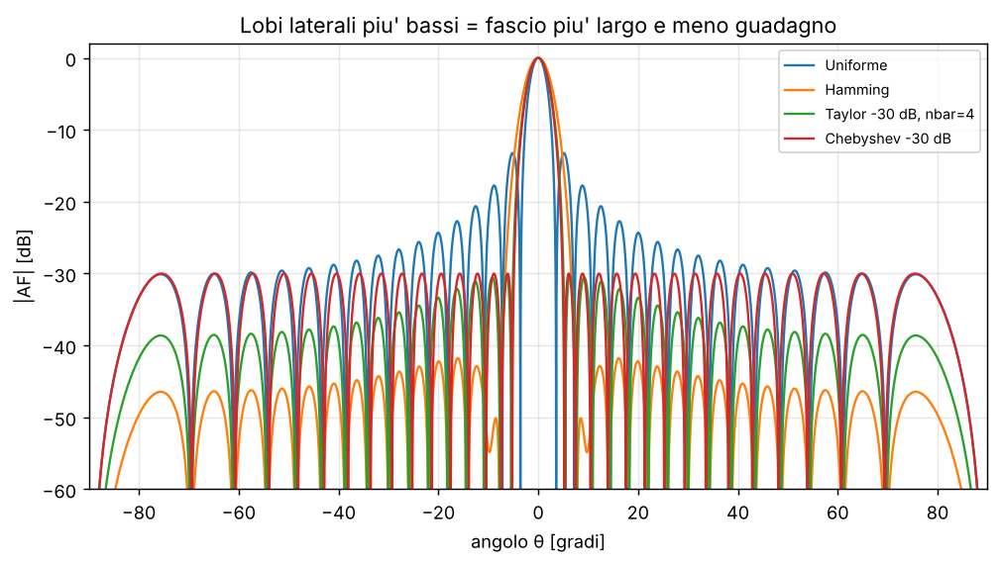
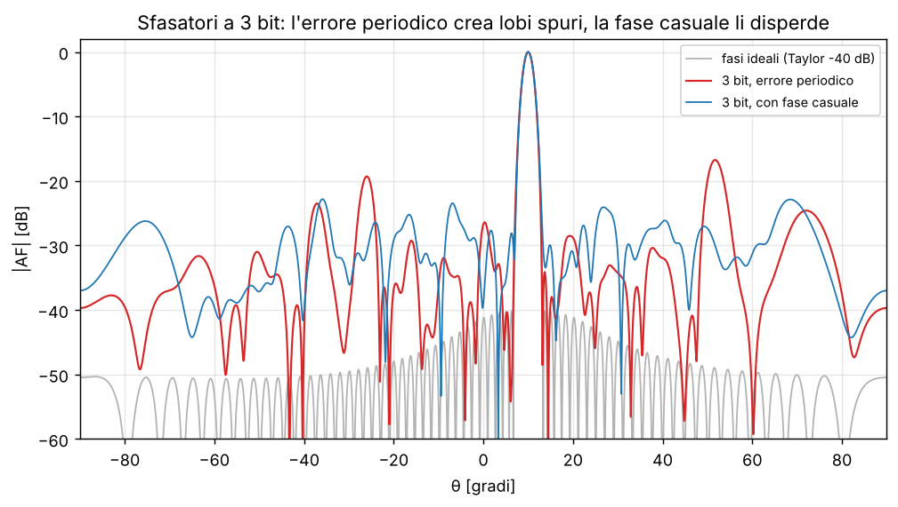
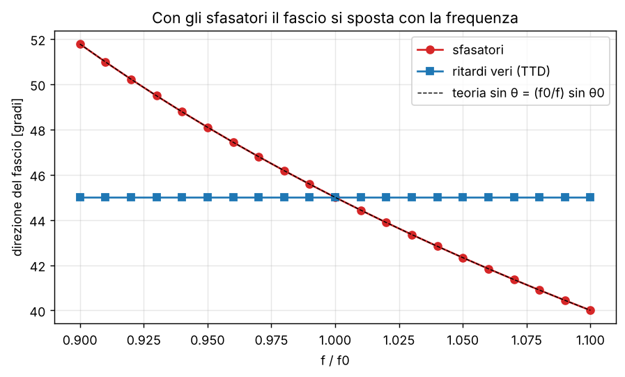
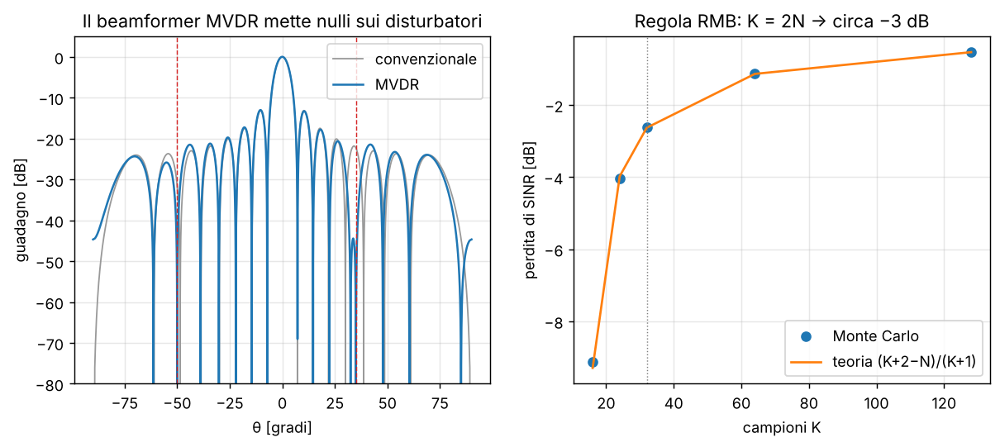
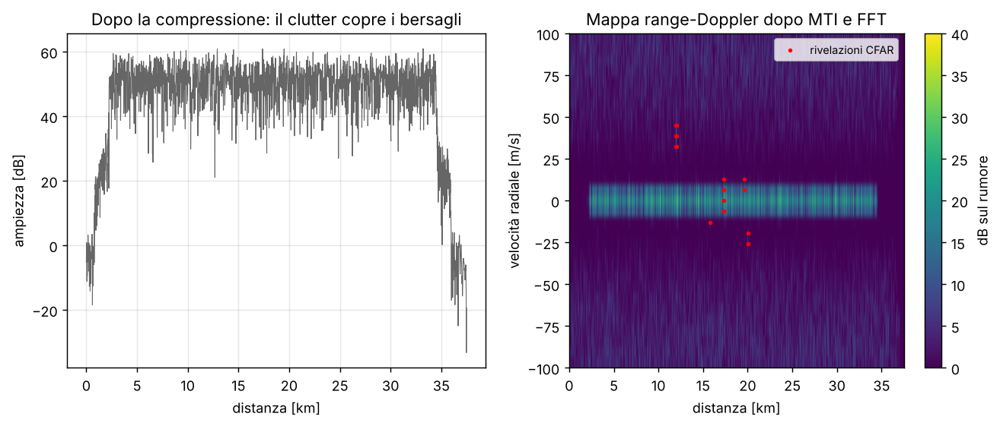
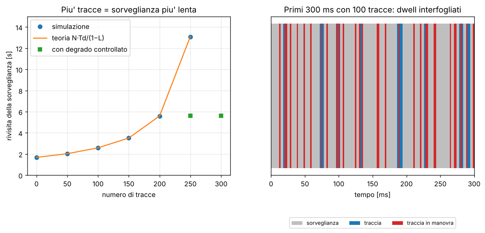

# Radar multifascio e multifunzione – simulazioni

Dieci simulazioni sui radar a scansione elettronica, dal singolo array di dipoli fino alla gestione del tempo di un radar multifunzione. Ogni argomento è implementato due volte, in **Python** e in **MATLAB**, con gli stessi parametri. Ogni script stampa il valore **misurato** dalla simulazione accanto al valore **teorico** dato dalla formula, così ogni formula diventa un esperimento che si può controllare. Un modello **Simulink** realizza un beamformer a ritardo vero con i fasci somma e differenza del monopulse.

Il materiale accompagna il documento *Radar multifascio e multifunzione a scansione elettronica*; tra parentesi è indicato il capitolo di riferimento.

---

## Indice

1. [Contenuto del repository](#1-contenuto-del-repository)
2. [Requisiti ed esecuzione](#2-requisiti-ed-esecuzione)
3. [Convenzioni e notazione](#3-convenzioni-e-notazione)
4. [Funzioni comuni](#4-funzioni-comuni)
5. [Le simulazioni](#5-le-simulazioni)
   - [p01 – Fattore di array e puntamento elettronico](#p01--fattore-di-array-e-puntamento-elettronico)
   - [p02 – Rastremazione delle ampiezze](#p02--rastremazione-delle-ampiezze)
   - [p03 – Grating lobes e spaziatura degli elementi](#p03--grating-lobes-e-spaziatura-degli-elementi)
   - [p04 – Sfasatori digitali e lobi di quantizzazione](#p04--sfasatori-digitali-e-lobi-di-quantizzazione)
   - [p05 – Squint di frequenza e ritardo vero](#p05--squint-di-frequenza-e-ritardo-vero)
   - [p06 – Multifascio con matrice di Butler](#p06--multifascio-con-matrice-di-butler)
   - [p07 – Monopulse e stima dell'angolo](#p07--monopulse-e-stima-dellangolo)
   - [p08 – Beamforming adattativo MVDR](#p08--beamforming-adattativo-mvdr)
   - [p09 – Catena range-Doppler e CA-CFAR](#p09--catena-range-doppler-e-ca-cfar)
   - [p10 – Gestione delle risorse del radar multifunzione](#p10--gestione-delle-risorse-del-radar-multifunzione)
6. [Il modello Simulink](#6-il-modello-simulink)
7. [Riepilogo dei risultati](#7-riepilogo-dei-risultati)
8. [Limiti e possibili estensioni](#8-limiti-e-possibili-estensioni)
9. [Riferimenti](#9-riferimenti)

---

## 1. Contenuto del repository

```
Radar-Multifunzione/
├── README.md
├── requirements.txt               dipendenze Python
├── risultati_python.txt           uscita completa di python/run_all.py
├── python/
│   ├── utils.py                   fattore di array, conversione in dB, misure sul diagramma
│   ├── p01_fattore_array_puntamento.py
│   ├── p02_rastremazione.py
│   ├── p03_grating_lobes.py
│   ├── p04_quantizzazione_sfasatori.py
│   ├── p05_squint_ttd.py
│   ├── p06_multifascio_butler.py
│   ├── p07_monopulse.py
│   ├── p08_beamforming_adattativo.py
│   ├── p09_catena_range_doppler_cfar.py
│   ├── p10_gestione_risorse.py
│   ├── run_all.py                 esegue tutte le simulazioni in ordine
│   └── figures/                   figure generate (PNG)
├── matlab/
│   ├── p01 … p10 (.m)             stesse simulazioni, stessi parametri
│   ├── run_all.m                  esegue tutte le simulazioni
│   └── utils/                     af, db_norm, larghezza_3db, lobo_laterale_max,
│                                  taylor_win, cheb_win, hamming_win, riga, salva_fig
└── simulink/
    ├── build_models.m             costruisce beamformer_ttd.slx con soli blocchi base
    └── simula_beamformer.m        scansione angolare del modello e confronto con la teoria
```

## 2. Requisiti ed esecuzione

### Python

Servono Python 3.9 o successivo, NumPy, SciPy e Matplotlib.

```bash
pip install -r requirements.txt
python python/run_all.py              # tutte le simulazioni (circa 20 s)
python python/p07_monopulse.py        # una sola simulazione
```

Le figure vengono salvate in `python/figures/`. L'uscita di `run_all.py` è riportata integralmente in `risultati_python.txt`.

### MATLAB

Serve MATLAB R2018b o successivo, **senza toolbox**. Le finestre di Taylor, Dolph-Chebyshev e Hamming sono implementate in `matlab/utils/` con lo stesso algoritmo di SciPy, quindi non serve il Signal Processing Toolbox.

```matlab
cd matlab
run_all                 % tutte le simulazioni
p07_monopulse           % una sola simulazione
```

Le figure vengono salvate in `matlab/figures/`. Ogni script viene eseguito da `run_all` nel proprio spazio di lavoro, quindi il `clear` iniziale degli script non interferisce con il ciclo.

### Simulink

```matlab
cd simulink
build_models            % crea beamformer_ttd.slx
simula_beamformer       % 181 simulazioni da -90° a +90° e confronto con la teoria
```

## 3. Convenzioni e notazione

| Simbolo | Significato | Unità |
| --- | --- | --- |
| N | numero di elementi dell'array | – |
| d | spaziatura tra elementi, **espressa in lunghezze d'onda** (d = 0,5 vuol dire λ/2) | λ |
| θ | angolo dalla normale all'array (*broadside*) | gradi |
| θ₀ | direzione di puntamento | gradi |
| u = sin θ | coseno direttore (spazio dei seni) | – |
| ψ = 2π d (u − u₀) | sfasamento tra elementi adiacenti | rad |
| w | vettore dei pesi complessi degli elementi | – |
| AF(u) | fattore di array | – |
| B, T | banda e durata dell'impulso | Hz, s |
| PRF, M | frequenza di ripetizione e numero di impulsi | Hz, – |

Le righe di uscita hanno sempre la forma:

```
  larghezza a -3 dB                          misurato =      7.337 deg   teorico =      7.327 deg
```

I generatori casuali hanno seme fisso, quindi ogni esecuzione dà gli stessi numeri. I risultati Monte Carlo di MATLAB differiscono leggermente da quelli Python perché i generatori sono diversi, ma seguono la stessa teoria.

## 4. Funzioni comuni

| Funzione (Python / MATLAB) | Cosa fa |
| --- | --- |
| `fattore_array(w, u, d)` / `af(w, u, d)` | Calcola AF(u) = Σₙ wₙ·e^{j2π d n u} su una griglia di u |
| `steering(N, u, d)` | Vettori di puntamento a(u) = [1, e^{j2πdu}, …, e^{j2πd(N−1)u}] |
| `db(x)` / `db_norm(x)` | Modulo in dB normalizzato al massimo, con pavimento a −80 dB |
| `larghezza_3db(x, p)` | Larghezza del lobo principale a −3 dB, con interpolazione lineare |
| `lobo_laterale_max(p)` | Livello del lobo laterale più alto rispetto al massimo |
| `riga(nome, misurato, teorico, unità)` | Stampa una riga di confronto |
| `taylor_win`, `cheb_win`, `hamming_win` | Finestre di rastremazione (solo MATLAB; in Python si usa SciPy) |

---

## 5. Le simulazioni

### p01 – Fattore di array e puntamento elettronico

*Capitoli 3 e 4 del documento.*

**Obiettivo.** Verificare che una rampa di fase lineare sposti il fascio nella direzione voluta, e misurare come si allarga il fascio e quanto guadagno si perde allontanandosi dalla normale.

**Teoria.** Con alimentazione uniforme e sfasamento progressivo α tra elementi adiacenti:

$$
\alpha = -2\pi\, d\, \sin\theta_0, \qquad
|AF(\psi)| = \left|\frac{\sin(N\psi/2)}{N\,\sin(\psi/2)}\right|
$$

$$
\theta_{3dB}(\theta_0) \approx \frac{0{,}886}{N\, d\, \cos\theta_0}\ \text{[rad]}, \qquad
\text{primo lobo laterale} \approx -13{,}26\ \text{dB}
$$

Con un diagramma dell'elemento ≈ cos θ (dipolo davanti a un piano di massa), il massimo del diagramma totale cala come cos θ₀.

**Parametri.** N = 16, d = λ/2, θ₀ = 0°, 30°, 60°, griglia di 36 001 angoli.

**Cosa fa lo script.**
1. Per ogni θ₀ calcola α e i pesi wₙ = e^{jαn}.
2. Calcola il fattore di array su tutta la griglia e lo converte in dB.
3. Misura direzione del massimo, larghezza a −3 dB e lobo laterale più alto.
4. Moltiplica per il diagramma dell'elemento cos θ e misura la perdita di scansione.

**Risultati.**

| θ₀ | α tra elementi | Larghezza misurata | Larghezza teorica | Perdita di scansione misurata | Teorica (cos θ₀) |
| --- | --- | --- | --- | --- | --- |
| 0° | 0° | 6,35° | 6,35° | 0 dB | 0 dB |
| 30° | −90,0° | 7,34° | 7,33° | −1,24 dB | −1,25 dB |
| 60° | −155,9° | 12,97° | 12,69° | −5,80 dB | −6,02 dB |

Il lobo laterale misurato è −13,15 dB: il valore −13,26 dB vale per N molto grande.


**Cosa osservare.** Il fascio si sposta senza cambiare forma nello spazio u, ma in θ si allarga di 1/cos θ₀. A 60° la formula sottostima leggermente la larghezza (12,97° contro 12,69°) perché l'approssimazione lineare perde precisione vicino all'*endfire*.

---

### p02 – Rastremazione delle ampiezze

*Capitolo 5.*

**Obiettivo.** Confrontare quattro distribuzioni di ampiezza e misurare il compromesso tra lobi laterali, larghezza del fascio e guadagno.

**Teoria.** Il fattore di array è la trasformata di Fourier discreta dei pesi: ogni finestra dell'analisi spettrale ha il suo equivalente spaziale. L'efficienza di rastremazione, cioè la perdita di guadagno rispetto all'uniforme, è:

$$
\eta_t = \frac{\left|\sum_n w_n\right|^2}{N \sum_n |w_n|^2}
$$

**Parametri.** N = 32, d = λ/2; finestre uniforme, Hamming, Taylor (−30 dB, n̄ = 4), Dolph-Chebyshev (−30 dB).

**Cosa fa lo script.**
1. Genera i pesi di ciascuna finestra.
2. Calcola il diagramma e misura il lobo laterale più alto.
3. Misura la larghezza a −3 dB e la divide per quella dell'uniforme.
4. Calcola l'efficienza η_t e la relativa perdita in dB.

**Risultati.**

| Distribuzione | Lobo laterale misurato | Valore nominale | Allargamento del fascio | Efficienza | Perdita |
| --- | --- | --- | --- | --- | --- |
| Uniforme | −13,2 dB | −13,3 dB | 1,00 | 1,000 | 0 dB |
| Hamming | −41,8 dB | −42,7 dB | 1,50 | 0,717 | 1,44 dB |
| Taylor −30 dB, n̄ = 4 | −30,2 dB | −30 dB | 1,27 | 0,853 | 0,69 dB |
| Dolph-Chebyshev −30 dB | −30,0 dB | −30 dB | 1,23 | 0,876 | 0,58 dB |



**Cosa osservare.** Chebyshev ha tutti i lobi laterali allo stesso livello e il fascio più stretto a parità di livello; Taylor ha solo i primi lobi a −30 dB e quelli lontani che calano. Abbassare i lobi da −13 a −30 dB costa circa il 25% di larghezza del fascio e 0,6–0,7 dB di guadagno.

---

### p03 – Grating lobes e spaziatura degli elementi

*Capitolo 6.*

**Obiettivo.** Mostrare quando, puntando lontano dalla normale, compare un secondo lobo alto quanto il principale.

**Teoria.** Il fattore di array è periodico in u con periodo 1/d. I massimi principali sono in:

$$
u_m = u_0 + \frac{m}{d}, \qquad m = 0, \pm 1, \pm 2, \dots
$$

Il grating lobe m = −1 resta fuori dallo spazio visibile (|u| ≤ 1) se:

$$
d < \frac{1}{1 + |\sin\theta_0|}
$$

**Parametri.** N = 16, θ₀ = 50°, d = 0,5 / 0,566 / 0,7 / 1,0 λ. Spaziatura massima teorica: 0,566 λ.

**Cosa fa lo script.**
1. Per ogni spaziatura punta l'array a 50°.
2. Calcola la posizione teorica del grating lobe u₀ − 1/d e dice se è nello spazio visibile.
3. Se è visibile, cerca il massimo nella zona prevista e ne misura posizione e livello.

**Risultati.**

| d | Grating lobe teorico (u) | Visibile? | Posizione misurata | Posizione teorica | Livello |
| --- | --- | --- | --- | --- | --- |
| 0,500 λ | −1,234 | no | – | – | – |
| 0,566 λ | −1,001 | no, al limite | – | – | – |
| 0,700 λ | −0,663 | sì | −41,50° | −41,49° | 0 dB |
| 1,000 λ | −0,234 | sì | −13,53° | −13,53° | 0 dB |


**Cosa osservare.** È lo stesso fenomeno dell'aliasing nel campionamento: gli elementi campionano il fronte d'onda nello spazio. Con d = 0,566 λ il grating lobe è esattamente sul bordo dello spazio visibile (−90°) e si vede già una parte del suo lobo: in pratica si progetta con un margine.

---

### p04 – Sfasatori digitali e lobi di quantizzazione

*Capitolo 8.2.*

**Obiettivo.** Misurare quanto costano gli sfasatori a pochi bit e mostrare come la fase casuale (*dithering*) elimina i lobi spuri.

**Teoria.** Con B bit il passo è 360°/2ᴮ. L'errore di fase ha distribuzione uniforme con valore efficace Δφ/√12, e la perdita media di guadagno è:

$$
\Delta G \approx \frac{\pi^2}{3}\, 2^{-2B}
$$

Con una rampa di fase lineare l'errore si ripete periodicamente lungo l'array e crea lobi spuri di livello indicativo 2⁻²ᴮ, cioè circa −6 dB per bit. Aggiungendo a ogni elemento una fase fissa nota pseudo-casuale, poi sottratta, l'errore diventa casuale e il lobo spurio si disperde in un fondo di lobi laterali.

**Parametri.** N = 64, d = λ/2, θ₀ = 10°, ampiezze Taylor −40 dB (perché i lobi laterali normali non coprano quelli spuri), B = 3, 4, 5.

**Cosa fa lo script.**
1. Calcola le fasi ideali per θ₀ = 10° e il diagramma di riferimento.
2. Arrotonda le fasi al passo dello sfasatore (errore periodico).
3. Ripete aggiungendo una fase casuale prima della quantizzazione e sottraendola dopo (dithering).
4. Misura la perdita di guadagno e il lobo spurio più alto fuori dai lobi vicini al principale.

**Risultati.**

| Bit | Passo | Perdita misurata | Perdita teorica | Lobo di quantizzazione (periodico) | Indicativo −6B dB | Lobo spurio con dithering |
| --- | --- | --- | --- | --- | --- | --- |
| 3 | 45° | 0,235 dB | 0,229 dB | −16,7 dB | −18,1 dB | −22,8 dB |
| 4 | 22,5° | 0,054 dB | 0,056 dB | −23,5 dB | −24,1 dB | −30,2 dB |
| 5 | 11,25° | 0,015 dB | 0,014 dB | −28,8 dB | −30,1 dB | −34,5 dB |



**Cosa osservare.** La perdita di guadagno è trascurabile già con 4 bit; il problema vero sono i lobi spuri. La regola dei −6 dB per bit è solo indicativa: il livello effettivo dipende dall'angolo di puntamento e qui è peggiore di 1–2 dB. Con il dithering il lobo spurio sparisce e si guadagnano circa 6 dB sul lobo più alto.

---

### p05 – Squint di frequenza e ritardo vero

*Capitolo 8.3–8.4.*

**Obiettivo.** Mostrare che uno sfasatore, che impone una fase costante, fa spostare il fascio quando cambia la frequenza, mentre un ritardo vero (TTD) no.

**Teoria.** Con sfasatori tarati a f₀:

$$
\sin\theta(f) = \frac{f_0}{f}\,\sin\theta_0, \qquad
\Delta\theta \approx -\frac{\Delta f}{f_0}\,\tan\theta_0
$$

Con ritardi τₙ = n d sin θ₀ / c lo sfasamento cresce con la frequenza e la direzione resta θ₀. La banda utile con sfasatori è circa:

$$
\frac{B}{f_0} \approx \frac{\theta_{3dB}}{\tan\theta_0}
$$

**Parametri.** N = 64, d = λ₀/2, θ₀ = 45°, f da 0,9 a 1,1 f₀ in passi dell'1%.

**Cosa fa lo script.**
1. Per ogni frequenza ricalcola la spaziatura elettrica d·f/f₀.
2. Con gli sfasatori tiene la fase calcolata a f₀; con il TTD la scala con la frequenza.
3. Misura la direzione del massimo nei due casi e la perdita di guadagno in θ₀ a f = 1,02 f₀.

**Risultati.**

| Verifica | Misurato | Teorico |
| --- | --- | --- |
| Direzione con sfasatori a 0,95 f₀ | 48,10° | 48,10° |
| Direzione con sfasatori a 1,05 f₀ | 42,33° | 42,33° |
| Direzione con TTD a 0,95 e 1,05 f₀ | 45,00° | 45,00° |
| Squint a +2% (formula linearizzata) | −1,11° | −1,15° |
| Perdita in θ₀ a 1,02 f₀, sfasatori | −3,15 dB | – |
| Perdita in θ₀ a 1,02 f₀, TTD | 0,00 dB | 0 dB |

Il fascio è largo 2,24°, quindi la banda utile con sfasatori è circa 3,9%: ai bordi di questa banda il bersaglio in θ₀ si trova a −3 dB, come conferma la misura a ±2%.



**Cosa osservare.** È il motivo per cui i radar a banda larga usano ritardi veri, almeno a livello di sottoarray.

---

### p06 – Multifascio con matrice di Butler

*Capitolo 10.2.*

**Obiettivo.** Generare N fasci simultanei ortogonali e verificare che la matrice di Butler equivale a una FFT spaziale.

**Teoria.** Gli N fasci della matrice di Butler puntano in:

$$
\sin\theta_m = \frac{m - 1/2}{N\, d}, \qquad m = -\tfrac{N}{2}+1, \dots, \tfrac{N}{2}
$$

Il massimo di ogni fascio cade sugli zeri di tutti gli altri (ortogonalità) e due fasci adiacenti si incrociano a circa −3,9 dB.

**Parametri.** N = 8, d = λ/2.

**Cosa fa lo script.**
1. Costruisce gli 8 vettori di pesi e i relativi diagrammi.
2. Misura la direzione di ogni fascio.
3. Calcola la matrice dei guadagni di ogni fascio nella direzione di ogni altro, per verificare l'ortogonalità.
4. Misura il livello di incrocio a metà strada tra due fasci.
5. Manda un'onda piana proveniente dalla direzione di un fascio in una FFT a 8 punti e verifica che si accenda un solo canale.

**Risultati.**

| Fascio | −3 | −2 | −1 | 0 | +1 | +2 | +3 | +4 |
| --- | --- | --- | --- | --- | --- | --- | --- | --- |
| Direzione (misurata = teorica) | −61,0° | −38,7° | −22,0° | −7,2° | 7,2° | 22,0° | 38,7° | 61,0° |

| Verifica | Misurato | Teorico |
| --- | --- | --- |
| Guadagno di un fascio nella direzione di un altro | −297 dB (zero numerico) | −∞ |
| Incrocio tra fasci adiacenti | −3,87 dB | −3,92 dB (N grande) |
| Uscite della FFT per un'onda dal fascio +2 | [0 0 0 0 0 0 1 0] | un solo canale acceso |


**Cosa osservare.** Con un'unica apertura si coprono 120° con 8 fasci contemporanei: è il principio della sorveglianza veloce dei radar multifascio, e il beamforming digitale lo realizza con una FFT.

---

### p07 – Monopulse e stima dell'angolo

*Capitolo 11.*

**Obiettivo.** Formare i fasci somma e differenza, verificare il rapporto monopulse e misurare con un Monte Carlo la precisione della stima angolare in funzione del rapporto segnale/rumore.

**Teoria.** Dividendo l'array in due metà S (sinistra) e D (destra):

$$
\Sigma = S + D, \qquad \Delta = S - D, \qquad
\operatorname{Im}\left\{-\frac{\Delta}{\Sigma}\right\} = \tan\!\left(\frac{N\pi d\,(u-u_0)}{2}\right) \approx k_m\,(u - u_0), \quad k_m = \frac{N\pi}{4}\ (d=\lambda/2)
$$

La deviazione standard della stima di u è:

$$
\sigma_u = \frac{1}{k_m\sqrt{2\,SNR_\Sigma}}
$$

con SNR_Σ rapporto segnale/rumore all'uscita del canale somma.

**Parametri.** N = 32, d = λ/2; bersaglio in u = 0,003; SNR_Σ da 10 a 30 dB; 4000 prove per ogni SNR.

**Cosa fa lo script.**
1. Calcola il rapporto monopulse senza rumore su una griglia di u e ne misura la pendenza vicino al centro.
2. Per ogni SNR genera 4000 realizzazioni del segnale con rumore gaussiano complesso su ogni elemento.
3. Stima u da ogni realizzazione e ne calcola la deviazione standard.

**Risultati.**

| Verifica | Misurato | Teorico |
| --- | --- | --- |
| Pendenza k_m | 25,16 | 25,13 |
| Rapporto in u = 0,03 | 0,939 | tan(0,754) = 0,939 |

| SNR_Σ | σᵤ misurata (×10⁻³) | σᵤ teorica (×10⁻³) |
| --- | --- | --- |
| 10 dB | 9,56 | 8,90 |
| 15 dB | 5,09 | 5,00 |
| 20 dB | 2,86 | 2,81 |
| 25 dB | 1,61 | 1,58 |
| 30 dB | 0,89 | 0,89 |

Con SNR = 20 dB la precisione è circa 1/20 della larghezza del fascio (0,0554 in u).


**Cosa osservare.** La formula è precisa ad alto SNR; a 10 dB l'errore reale è un po' più grande perché il rapporto Δ/Σ non è più lineare nel rumore. Il rapporto non dipende dall'ampiezza dell'eco, quindi la misura si fa con un solo impulso.

---

### p08 – Beamforming adattativo MVDR

*Capitolo 12.*

**Obiettivo.** Mostrare come i pesi ottimi mettano zeri nelle direzioni dei disturbatori, e verificare quanti campioni servono per stimare la matrice di covarianza (regola di Reed-Mallett-Brennan).

**Teoria.** Con R matrice di covarianza di disturbo più rumore e a(θ₀) vettore di puntamento verso il bersaglio:

$$
\mathbf{w}_{opt} = \frac{\mathbf{R}^{-1}\mathbf{a}(\theta_0)}{\mathbf{a}^H(\theta_0)\,\mathbf{R}^{-1}\,\mathbf{a}(\theta_0)}, \qquad
SINR_{opt} = \mathbf{a}^H\mathbf{R}^{-1}\mathbf{a}
$$

Stimando R con K campioni (SMI) la perdita media di SINR rispetto all'ottimo è:

$$
E[\rho] = \frac{K + 2 - N}{K + 1} \qquad (K = 2N \Rightarrow \approx -3\ \text{dB})
$$

**Parametri.** N = 16, d = λ/2; bersaglio a 0°; due disturbatori a +35° e −50° con rapporto disturbo/rumore 40 dB per elemento; K = 16, 24, 32, 64, 128 con 200 prove ciascuno.

**Cosa fa lo script.**
1. Costruisce R = I + JNR·Σ aⱼaⱼᴴ e calcola i pesi ottimi e quelli convenzionali.
2. Confronta il SINR dei due beamformer e il guadagno verso ciascun disturbatore.
3. Per ogni K genera campioni di disturbo con covarianza R (fattorizzazione di Cholesky), stima R̂ e calcola la perdita di SINR.

**Risultati.**

| Verifica | Convenzionale | MVDR |
| --- | --- | --- |
| SINR rispetto a N (ottimo teorico −0,03 dB) | −30,2 dB | −0,03 dB |
| Guadagno verso il disturbatore a +35° | −22,3 dB | −96,9 dB |
| Guadagno verso il disturbatore a −50° | −31,6 dB | −82,8 dB |

| Campioni K | Perdita SMI misurata | Teorica |
| --- | --- | --- |
| 16 (= N) | −9,12 dB | −9,29 dB |
| 24 | −4,03 dB | −3,98 dB |
| 32 (= 2N) | −2,61 dB | −2,63 dB |
| 64 | −1,14 dB | −1,14 dB |
| 128 | −0,54 dB | −0,54 dB |



**Cosa osservare.** Il beamformer convenzionale, con lobi laterali a −22 dB, lascia passare disturbatori 40 dB sopra il rumore e perde 30 dB di SINR. Il MVDR mette zeri profondi sui disturbatori e torna praticamente all'ottimo. Con K = 2N la perdita è 2,6 dB: la regola dei "3 dB con 2N campioni" è un'approssimazione per N grande.

---

### p09 – Catena range-Doppler e CA-CFAR

*Capitolo 13.*

**Obiettivo.** Simulare l'intera catena di elaborazione di un fascio e verificare risoluzione, rivelazione dei bersagli e probabilità di falso allarme.

**Teoria.**

| Blocco | Formula |
| --- | --- |
| Filtro adattato / compressione | Risoluzione ΔR = 0,886·c/(2B) a −3 dB, lobi laterali −13,26 dB |
| Cancellatore MTI a 2 impulsi | yₙ = xₙ − xₙ₋₁, \|H(f)\| = 2\|sin(πf/PRF)\| |
| FFT Doppler su M impulsi | risoluzione in velocità λ·PRF/(2M) |
| CA-CFAR (rivelatore quadratico) | soglia α·Z con α = N_ref·(P_fa^{−1/N_ref} − 1) |

**Parametri.**

| Parametro | Valore |
| --- | --- |
| Frequenza portante | 3 GHz (λ = 10 cm) |
| Chirp | B = 5 MHz, T = 10 µs, campionamento 10 MHz |
| Treno di impulsi | M = 32, PRF = 4 kHz (distanza non ambigua 37,5 km) |
| Bersagli | 12,00 km a +40 m/s; 20,01 km a −25 m/s |
| Clutter | 30 dB sopra il rumore per campione, da 2 a 35 km, moto interno 4 Hz rms |
| Doppler | finestra di Chebyshev a −60 dB su 31 impulsi (dopo l'MTI) |
| CA-CFAR | 32 celle di riferimento, 4 di guardia per lato, P_fa = 10⁻⁶ |

**Cosa fa lo script.**
1. Misura risoluzione, lobi laterali e guadagno di compressione su un chirp sovracampionato.
2. Genera i 32 echi con bersagli, clutter e rumore.
3. Applica filtro adattato, MTI, finestra e FFT Doppler, e calcola la potenza.
4. Applica il CA-CFAR lungo la distanza in ogni cella Doppler e confronta le rivelazioni con i bersagli veri.
5. Ripete su solo rumore con P_fa = 10⁻³ e conta i falsi allarmi, sia su tutte le celle sia su una cella sì e una no.

**Risultati.**

| Verifica | Misurato | Teorico |
| --- | --- | --- |
| Risoluzione in distanza | 26,4 m | 26,6 m |
| Lobo laterale di compressione | −13,6 dB | −13,3 dB |
| Guadagno di compressione | 20,0 dB | 20,0 dB (T·fs = 100) |
| Soglia CA-CFAR | 17,28 (12,4 dB) | 17,28 |
| Bersaglio 1: distanza / velocità | 12 000 m / 38,7 m/s | 12 000 m / 40 m/s |
| Bersaglio 2: distanza / velocità | 20 010 m / −25,8 m/s | 20 010 m / −25 m/s |
| P_fa su tutte le celle | 1,55·10⁻³ | 1,0·10⁻³ |
| P_fa su celle indipendenti | 0,94·10⁻³ | 1,0·10⁻³ |

Le velocità sono quantizzate dalla risoluzione Doppler di 6,45 m/s.



**Cosa osservare.**
- Dopo la sola compressione il clutter è 50 dB sopra il rumore e copre i bersagli; dopo MTI e FFT i bersagli escono nettamente nelle loro celle di velocità.
- Restano poche rivelazioni da residui di clutter vicino a velocità zero: un MTI a 2 impulsi non cancella completamente un clutter con moto interno.
- Il CA-CFAR suppone celle di riferimento indipendenti. Campionando a 1/(2B) le celle adiacenti sono correlate, la stima del rumore è peggiore e i falsi allarmi crescono del 55%. Usando una cella sì e una no la P_fa torna al valore nominale.

---

### p10 – Gestione delle risorse del radar multifunzione

*Capitolo 14.*

**Obiettivo.** Simulare uno scheduler che divide il tempo tra sorveglianza e inseguimento, e verificare l'effetto del numero di tracce sul tempo di rivisita della sorveglianza.

**Teoria.**

$$
L = \sum_i \frac{T_{dwell,i}}{T_{upd,i}}, \qquad
T_s = \frac{N_{beam}\, T_{dwell,s}}{1 - L}, \qquad
\frac{R}{R_0} = (1 - L)^{1/4}\ \text{(a rivisita fissa)}
$$

**Parametri.**

| Parametro | Valore |
| --- | --- |
| Sorveglianza | 420 posizioni di fascio da 4 ms (1,68 s per scansione senza tracce) |
| Tracce | dwell 2 ms; 3 su 4 aggiornate ogni 1 s, 1 su 4 in manovra ogni 0,25 s |
| Scheduler | una traccia scaduta ha la precedenza (si serve la più in ritardo), altrimenti sorveglianza |
| Degrado controllato | se L > 80%, le tracce non in manovra vengono rallentate per riportare L al 70% |
| Durata simulata | 30 s per ogni caso |

**Cosa fa lo script.**
1. Per ogni numero di tracce simula 30 s di funzionamento dwell per dwell.
2. Misura il tempo medio di una scansione completa di sorveglianza e il ritardo degli aggiornamenti di traccia.
3. Oltre l'80% di carico ripete la simulazione con il degrado controllato.

**Risultati.**

| Tracce | Carico L | Rivisita misurata | Rivisita teorica | Ritardo max delle tracce | Portata relativa |
| --- | --- | --- | --- | --- | --- |
| 0 | 0% | 1,68 s | 1,68 s | 0 ms | 100% |
| 50 | 17,2% | 2,03 s | 2,03 s | 5,1 ms | 95,4% |
| 100 | 35,0% | 2,58 s | 2,59 s | 8,1 ms | 89,8% |
| 150 | 52,2% | 3,51 s | 3,52 s | 12,6 ms | 83,1% |
| 200 | 70,0% | 5,60 s | 5,60 s | 13,2 ms | 74,0% |
| 250 | 87,2% | 13,08 s | 13,13 s | 16,4 ms | 59,8% |
| 300 | 105% | saturazione | – | 1447 ms | – |

Con il degrado controllato, a 250 tracce il carico torna al 70% e la rivisita a 5,60 s, con le tracce non in manovra aggiornate ogni 1,84 s. A 300 tracce il radar esce dalla saturazione: rivisita 5,60 s e ritardo massimo delle tracce 25 ms, con le tracce lente aggiornate ogni 4,5 s.



**Cosa osservare.** Il tempo di rivisita esplode quando il carico si avvicina al 100%: è il compromesso fondamentale del radar multifunzione. Senza gestione del sovraccarico, a 300 tracce la sorveglianza si ferma e gli aggiornamenti arrivano con quasi 1,5 s di ritardo. Il degrado controllato sacrifica la frequenza di aggiornamento delle tracce meno critiche per salvare sorveglianza e tracce in manovra.

---

## 6. Il modello Simulink

`build_models.m` costruisce il modello **beamformer_ttd** usando solo blocchi della libreria base di Simulink.

**Schema.**

```
Elemento 0 (Sine Wave) ─► Ritardo 0 (Transport Delay) ─┬─► Somma ──────► 1/8 ─► sigma_out, Scope
Elemento 1 (Sine Wave) ─► Ritardo 1 (Transport Delay) ─┤
   …                                                   │
Elemento 7 (Sine Wave) ─► Ritardo 7 (Transport Delay) ─┴─► Differenza ─► 1/8 ─► delta_out, Scope
                                                        (+ + + + − − − −)
```

**Come funziona.**
- L'onda in arrivo è una sinusoide con periodo 1 s, quindi λ/c = 1 s e la spaziatura λ/2 corrisponde a 0,5 s di ritardo massimo tra elementi adiacenti.
- Ogni **Sine Wave** rappresenta il segnale ricevuto dall'elemento n, con fase −2π·0,5·n·sin(θ_src) dovuta al ritardo di arrivo dalla direzione θ_src.
- Ogni **Transport Delay** applica il ritardo vero che compensa la direzione di puntamento θ₀:
  τₙ = 0,5·[max(sin θ₀, 0)·(N−1−n) + max(−sin θ₀, 0)·n].
  La formula tiene tutti i ritardi positivi, come richiede un blocco fisico.
- Il blocco **Somma** forma il fascio Σ, il blocco **Differenza** (prima metà meno seconda metà) forma il fascio Δ del monopulse.
- Solutore a passo fisso `ode3` con passo 0,01 s, durata 10 s.

**La scansione.** `simula_beamformer.m` punta il modello a θ₀ = 20° e fa variare θ_src da −90° a +90° in passi di 1°, con `Simulink.SimulationInput`. Per ogni direzione misura l'ampiezza di Σ e Δ nell'ultimo secondo e la confronta con:

$$
|\Sigma| = \left|\frac{\sin(N\psi/2)}{N\sin(\psi/2)}\right|, \qquad
|\Delta| = \frac{2\sin^2(N\psi/4)}{N\,|\sin(\psi/2)|}, \qquad \psi = \pi(\sin\theta_{src} - \sin\theta_0)
$$

Lo script stampa la direzione del massimo di Σ, il valore di Δ in θ₀ (deve essere zero) e l'errore massimo tra simulazione e teoria. Le stesse equazioni del modello, riprodotte numericamente in Python, danno un errore massimo di 4·10⁻⁴, dovuto solo al campionamento del picco della sinusoide.

**Perché ritardi veri.** Con i Transport Delay il modello è un beamformer a ritardo vero: cambiando la frequenza della Sine Wave il fascio resta puntato a θ₀, a differenza degli sfasatori di p05.

---

## 7. Riepilogo dei risultati

| Script | Verifica principale | Misurato | Teorico |
| --- | --- | --- | --- |
| p01 | Larghezza del fascio a 30° | 7,34° | 7,33° |
| p02 | Lobo laterale Taylor −30 dB | −30,2 dB | −30 dB |
| p03 | Grating lobe con d = 0,7λ | −41,50° | −41,49° |
| p04 | Perdita con sfasatori a 4 bit | 0,054 dB | 0,056 dB |
| p05 | Squint a 1,05 f₀ | 42,33° | 42,33° |
| p06 | Incrocio tra fasci di Butler | −3,87 dB | −3,92 dB |
| p07 | σᵤ monopulse a 20 dB (×10⁻³) | 2,86 | 2,81 |
| p08 | Perdita SMI con K = 2N | −2,61 dB | −2,63 dB |
| p09 | P_fa del CA-CFAR su celle indipendenti | 0,94·10⁻³ | 1,0·10⁻³ |
| p10 | Rivisita con 150 tracce | 3,51 s | 3,52 s |

## 8. Limiti e possibili estensioni

**Limiti delle simulazioni.**
- Gli array sono lineari; gli array planari (capitolo 7) si ottengono come prodotto di due array lineari solo con pesi separabili.
- Il diagramma dell'elemento è approssimato con cos θ; l'accoppiamento mutuo e la cecità di scansione non sono modellati.
- In p09 il clutter è a Doppler quasi nullo e i bersagli sono puntiformi e non fluttuanti.
- In p10 lo scheduler usa solo priorità e scadenze, senza sorveglianza differenziata per settore.

**Possibili estensioni.**
- Array planare con griglia triangolare e grating lobes nel piano (u, v).
- Errori casuali di ampiezza e fase e calibrazione dei moduli T/R.
- Sottoarray con ritardi veri e lobi di sottoarray in banda larga.
- Monopulse con beamforming adattativo che preserva la pendenza.
- Bersagli fluttuanti (Swerling) e curve di probabilità di rivelazione.
- Scheduler con sorveglianza a settori e forme d'onda diverse per funzione.

## 9. Riferimenti

- *Radar multifascio e multifunzione a scansione elettronica* – documento di riferimento di queste simulazioni (capitoli indicati per ogni script).
- R. J. Mailloux, *Phased Array Antenna Handbook*, Artech House.
- C. A. Balanis, *Antenna Theory: Analysis and Design*, Wiley.
- M. I. Skolnik, *Radar Handbook*, McGraw-Hill.
- M. A. Richards, *Fundamentals of Radar Signal Processing*, McGraw-Hill.
- H. L. Van Trees, *Optimum Array Processing*, Wiley.

## Autore

Luca Buccilli – Laurea magistrale in Ingegneria delle Telecomunicazioni, Sapienza Università di Roma
