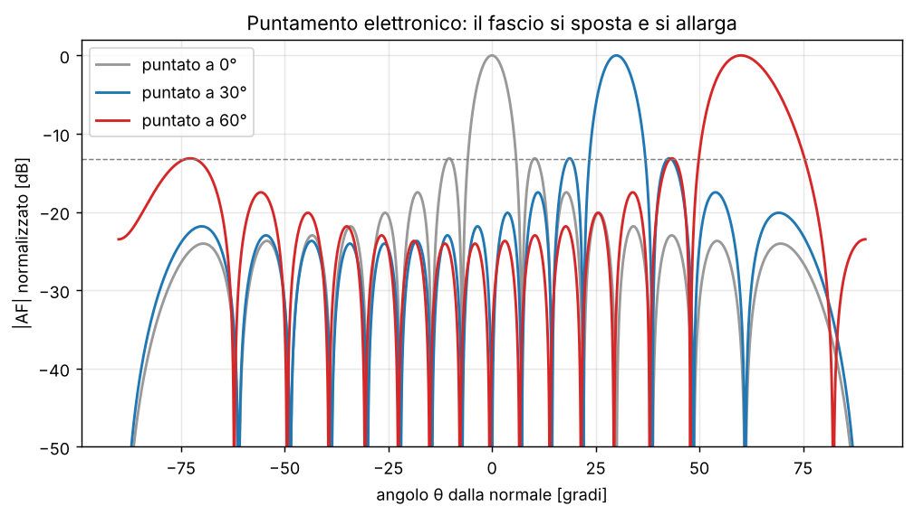
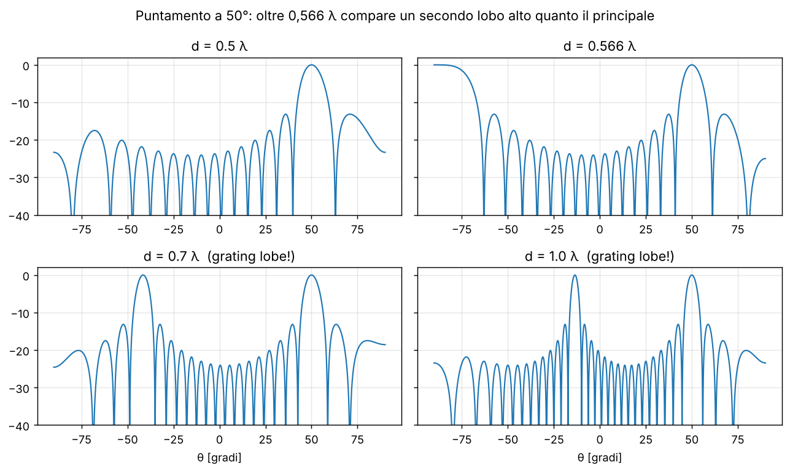
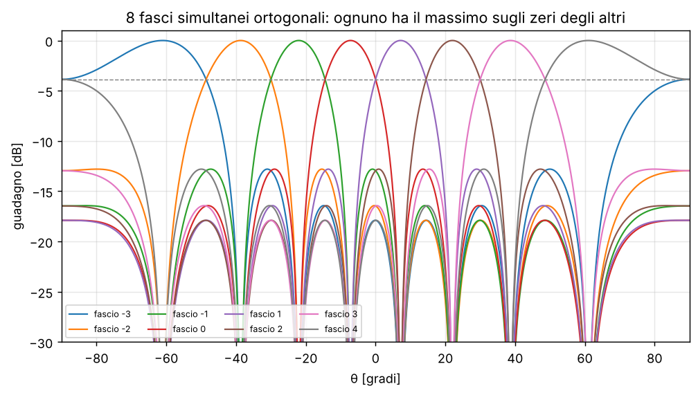
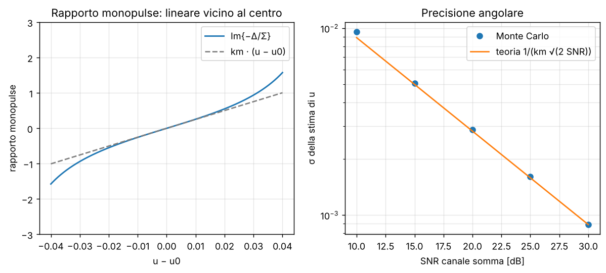

# Multibeam and Multifunction Phased-Array Radar – MATLAB, Simulink and Python Simulations

I built this project to study, through simulation, the key concepts behind electronically scanned multibeam and multifunction radars: from a single linear array of dipoles to the time management of a multifunction radar. It covers beam steering, amplitude tapering, grating lobes, digital phase shifters, frequency squint and true time delay, Butler multibeam networks, monopulse angle estimation, adaptive beamforming, the full range-Doppler processing chain with CA-CFAR detection, and radar resource scheduling.

**MATLAB is the main implementation.** It is the reference tool in the radar and defence industry for feasibility studies, antenna analysis and algorithm prototyping, and Simulink is the standard for block-level system modelling. I wrote every simulation in **plain MATLAB with no toolboxes**: the functions that normally come from the Signal Processing Toolbox (Taylor, Dolph-Chebyshev and Hamming windows) are implemented in my own library `matlab/utils/` and explained below. A **Python** version runs exactly the same steps with the same parameters and serves as an independent cross-check.

Every script prints the **measured** value next to the **theoretical** one, so that each textbook formula becomes an experiment I can verify. A **Simulink** model implements an 8-element true-time-delay beamformer with the sum and difference beams used in monopulse.

---

## Table of contents

1. [Repository structure](#1-repository-structure)
2. [Requirements and how to run](#2-requirements-and-how-to-run)
3. [Conventions and notation](#3-conventions-and-notation)
4. [The MATLAB library `matlab/utils`](#4-the-matlab-library-matlabutils)
5. [Simulations](#5-simulations)
   - [p01 – Array factor and electronic beam steering](#p01--array-factor-and-electronic-beam-steering)
   - [p02 – Amplitude tapering](#p02--amplitude-tapering)
   - [p03 – Grating lobes and element spacing](#p03--grating-lobes-and-element-spacing)
   - [p04 – Digital phase shifters and quantization lobes](#p04--digital-phase-shifters-and-quantization-lobes)
   - [p05 – Frequency squint and true time delay](#p05--frequency-squint-and-true-time-delay)
   - [p06 – Multibeam forming with a Butler matrix](#p06--multibeam-forming-with-a-butler-matrix)
   - [p07 – Monopulse angle estimation](#p07--monopulse-angle-estimation)
   - [p08 – Adaptive beamforming (MVDR)](#p08--adaptive-beamforming-mvdr)
   - [p09 – Range-Doppler processing chain and CA-CFAR](#p09--range-doppler-processing-chain-and-ca-cfar)
   - [p10 – Multifunction radar resource management](#p10--multifunction-radar-resource-management)
6. [The Simulink model](#6-the-simulink-model)
7. [MATLAB techniques used](#7-matlab-techniques-used)
8. [MATLAB ↔ Python mapping](#8-matlab--python-mapping)
9. [Summary of results](#9-summary-of-results)
10. [Limitations and next steps](#10-limitations-and-next-steps)
11. [References](#11-references)

---

## 1. Repository structure

```
Radar-Multifunzione/
├── README.md
├── matlab/                         MAIN IMPLEMENTATION
│   ├── p01_fattore_array_puntamento.m
│   ├── p02_rastremazione.m
│   ├── p03_grating_lobes.m
│   ├── p04_quantizzazione_sfasatori.m
│   ├── p05_squint_ttd.m
│   ├── p06_multifascio_butler.m
│   ├── p07_monopulse.m
│   ├── p08_beamforming_adattativo.m
│   ├── p09_catena_range_doppler_cfar.m
│   ├── p10_gestione_risorse.m
│   ├── run_all.m                   runs every simulation in order
│   └── utils/                      shared library (no toolbox required)
│       ├── af.m                    array factor
│       ├── db_norm.m               normalized magnitude in dB
│       ├── larghezza_3db.m         -3 dB main-lobe width
│       ├── lobo_laterale_max.m     highest sidelobe level
│       ├── taylor_win.m            Taylor weights
│       ├── cheb_win.m              Dolph-Chebyshev weights
│       ├── hamming_win.m           Hamming weights
│       ├── riga.m                  "measured vs theoretical" printout
│       └── salva_fig.m             saves figures to matlab/figures/
├── simulink/
│   ├── build_models.m              builds beamformer_ttd.slx from a script
│   └── simula_beamformer.m         angular sweep of the model vs theory
├── python/                         CROSS-CHECK
│   ├── p01 … p10 (.py)             same simulations, same parameters
│   ├── utils.py
│   ├── run_all.py
│   └── figures/                    generated figures
├── risultati_python.txt            full output of python/run_all.py
└── requirements.txt
```

File names, variable names and code comments are in Italian. The code excerpts in this document keep the original identifiers, with comments translated into English.

## 2. Requirements and how to run

### MATLAB

**MATLAB R2018b or later**, no toolboxes. The newest functions I use are `yline`, `xline` and `sgtitle` (R2018b) and implicit expansion (R2016b).

```matlab
cd matlab
run_all                         % every simulation, one after the other
p07_monopulse                   % a single simulation
```

Each script adds the `utils` folder to the path by itself:

```matlab
addpath(fullfile(fileparts(mfilename('fullpath')), 'utils'));
```

Figures are saved to `matlab/figures/`, which is created on the first run. Since each script starts with `clear; close all;`, I wrote `run_all` as a **function** that runs every script inside a helper function. This way the `clear` of one script cannot wipe the loop variables:

```matlab
function run_all()
cartella = fileparts(mfilename('fullpath'));
script = dir(fullfile(cartella, 'p*.m'));
for k = 1:numel(script)
    esegui(fullfile(cartella, script(k).name));      % each script in its own workspace
end
end

function esegui(file)
run(file);
end
```

### Simulink

```matlab
cd simulink
build_models            % creates beamformer_ttd.slx using library blocks only
simula_beamformer       % 181 simulations from -90° to +90°, compared with theory
```

### Python (cross-check)

```bash
pip install -r requirements.txt     # numpy, scipy, matplotlib
python python/run_all.py            # about 20 s
```

### Verification

The numerical results reported in this document come from the Python run, stored in full in `risultati_python.txt`. The MATLAB scripts use the same parameters and the same algorithms; I checked that my `taylor_win` and `cheb_win` produce the same weights as SciPy (difference below 10⁻¹⁵). Deterministic results are therefore expected to match exactly between the two languages, while Monte Carlo results (p07, p08, p09) differ slightly because the random number generators are different, but follow the same theory.

## 3. Conventions and notation

| Symbol | Meaning | In the MATLAB code |
| --- | --- | --- |
| N | number of elements | `N` |
| d | element spacing **in wavelengths** (0.5 = λ/2) | `d` |
| θ, θ₀ | angle from broadside, steering direction (degrees) | `theta`, `theta0` |
| u = sin θ | direction cosine | `u = sind(theta)` |
| ψ | inter-element phase difference, 2π d (u − u₀) | `psi` |
| w | complex element weights | `w` |
| AF(u) | array factor | `af(w, u, d)` |
| B, T, fs | bandwidth, pulse length, sampling rate | `B`, `T`, `fs` |
| PRF, M | pulse repetition frequency, number of pulses | `PRF`, `M` |

I use MATLAB's degree-based trigonometric functions (`sind`, `cosd`, `asind`) throughout: the code reads in the same units as the plots.

Every check is printed in the same format:

```
  larghezza a -3 dB                          misurato =      7.337 deg   teorico =      7.327 deg
```

(*larghezza a −3 dB* = −3 dB beamwidth, *misurato* = measured, *teorico* = theoretical.)

---

## 4. The MATLAB library `matlab/utils`

### 4.1 `af.m` – the array factor

```matlab
function y = af(w, u, d)
n = 0:numel(w)-1;
y = exp(1j*2*pi*d*u(:)*n) * w(:);
end
```

This is the core of every simulation. `u(:)` is a column of M angles and `n` a row of N element indices, so `u(:)*n` is the M × N matrix of phases 2π d u n. Multiplying it by the weight column `w(:)` evaluates the array factor on the whole angular grid **in one line, without loops**:

$$
AF(u_m) = \sum_{n=0}^{N-1} w_n\, e^{\,j 2\pi d\, n\, u_m}
$$

It is a typical example of MATLAB **vectorization**: a double loop over angles and elements becomes a single matrix-vector product.

### 4.2 Pattern measurements

- `db_norm(x, floor_db)` normalizes the magnitude to its peak and converts it to dB, with a floor (−80 dB by default) to avoid log(0).
- `larghezza_3db(x, p)` starts from the peak, walks left and right while the pattern stays above −3 dB, then uses `interp1` to locate the exact crossing between two samples.
- `lobo_laterale_max(p)` walks down from the peak to the first null on each side (the end of the main lobe) and returns the maximum of what remains.

### 4.3 `taylor_win.m` – Taylor weights

I implemented the Taylor distribution with the same algorithm used by SciPy. Given the sidelobe level SLL and the number n̄ of nearly constant sidelobes:

$$
A = \frac{\operatorname{arccosh}\left(10^{SLL/20}\right)}{\pi}, \qquad
\sigma^2 = \frac{\bar n^2}{A^2 + (\bar n - 1/2)^2}
$$

$$
F_m = \frac{(-1)^{m+1} \prod_{i=1}^{\bar n-1}\left(1 - \frac{m^2/\sigma^2}{A^2 + (i - 1/2)^2}\right)}{2\prod_{i \ne m}\left(1 - \frac{m^2}{i^2}\right)}, \qquad
w_n = 1 + 2\sum_{m=1}^{\bar n-1} F_m \cos\!\left(\frac{2\pi m\,(n - N/2 + 1/2)}{N}\right)
$$

```matlab
for mi = 1:nbar-1
    m = ma(mi);
    segno = (-1)^(mi+1);
    numer = segno * prod(1 - m^2/s2 ./ (A^2 + (ma - 0.5).^2));
    altri = ma([1:mi-1, mi+1:end]);            % every index except m
    denom = 2 * prod(1 - m^2 ./ altri.^2);
    Fm(mi) = numer / denom;
end
n = 0:N-1;
w = 1 + 2 * (Fm * cos(2*pi*ma(:) * (n - N/2 + 0.5) / N));
```

In the last line the row `Fm` multiplies the (n̄−1) × N matrix of cosines, so all N weights are computed at once.

### 4.4 `cheb_win.m` – Dolph-Chebyshev weights

The Dolph-Chebyshev array factor is a Chebyshev polynomial of order N−1. The algorithm samples this polynomial in the spatial-frequency domain and inverse-transforms it to obtain the weights:

$$
\beta = \cosh\!\left(\frac{\operatorname{arccosh}(10^{SLL/20})}{N-1}\right), \qquad
x_k = \beta\cos\frac{\pi k}{N}, \qquad
T_{N-1}(x) = \begin{cases} \cos((N-1)\arccos x) & |x| \le 1 \\ \cosh((N-1)\operatorname{arccosh} x) & |x| > 1 \end{cases}
$$

```matlab
x = beta * cos(pi*k/N);
p = zeros(1, N);
i1 = x > 1;       p(i1) = cosh(order * acosh(x(i1)));
i2 = x < -1;      p(i2) = (2*mod(N,2) - 1) * cosh(order * acosh(-x(i2)));
i3 = abs(x) <= 1; p(i3) = cos(order * acos(x(i3)));
...
p = p .* exp(1j*pi/N*(0:N-1));                 % even N: half-sample shift
w = real(fft(p));
w = [w(n:-1:2), w(2:n)];                       % rebuild the symmetric window
```

The three logical masks `i1`, `i2`, `i3` pick the right branch for each sample without loops (**logical indexing**). For even N a half-sample phase shift is applied before the FFT, and the symmetric window is rebuilt by joining the reversed and the direct halves.

### 4.5 Other helpers

| Function | Purpose |
| --- | --- |
| `hamming_win(N)` | 0.54 − 0.46·cos(2πn/(N−1)) |
| `riga(name, measured, theoretical, unit)` | aligned `fprintf` output (`%-42s`, `%10.3f`) |
| `salva_fig(fig, name)` | creates `matlab/figures/` if needed and saves with `print(fig, path, '-dpng', '-r130')` |

---

## 5. Simulations

For each simulation I describe the objective, the theory, the parameters, the **MATLAB implementation** with its key code, the results, the figure and what the results show. The figures shown here come from the Python run; MATLAB produces the same plots in `matlab/figures/`.

### p01 – Array factor and electronic beam steering

*File: `matlab/p01_fattore_array_puntamento.m`*

**Objective.** Verify that a linear phase taper steers the beam to the desired direction, and measure how the beam broadens and how much gain is lost when scanning away from broadside.

**Theory.**

$$
\alpha = -2\pi\, d\, \sin\theta_0, \qquad
|AF(\psi)| = \left|\frac{\sin(N\psi/2)}{N\,\sin(\psi/2)}\right|, \qquad
\theta_{3dB}(\theta_0) \approx \frac{0.886}{N\, d\, \cos\theta_0}\ \text{[rad]}
$$

First sidelobe ≈ −13.26 dB (large N). With an element pattern ≈ cos θ (a dipole in front of a ground plane), the peak of the total pattern drops as cos θ₀.

**Parameters.** N = 16, d = λ/2, θ₀ = 0°, 30°, 60°, grid of 36 001 angles from −90° to +90°.

**MATLAB implementation.**

```matlab
theta = linspace(-90, 90, 36001);
u = sind(theta);
for k = 1:3
    theta0 = angoli(k);
    alpha = -2*pi*d*sind(theta0);                % progressive phase shift
    w = exp(1j*alpha*(0:N-1));                    % phase-only weights
    p = db_norm(af(w, u, d));                     % pattern in dB
    [~, im] = max(p);                             % index of the peak
    riga('direzione del massimo', theta(im), theta0, 'deg');
    riga('larghezza a -3 dB', larghezza_3db(theta, p), rad2deg(0.886/(N*d*cosd(theta0))), 'deg');
end
```

1. The weights are pure phases: `exp(1j*alpha*(0:N-1))` creates [1, e^{jα}, e^{j2α}, …] in one step.
2. `[~, im] = max(p)` returns the index of the peak; the tilde discards the value.
3. For the scan loss the element pattern is applied element-wise: `tot = cosd(theta(:)) .* abs(af(w, u, d))`.

**Results.**

| θ₀ | Phase step α | Measured beamwidth | Theoretical | Measured scan loss | Theoretical (cos θ₀) |
| --- | --- | --- | --- | --- | --- |
| 0° | 0° | 6.35° | 6.35° | 0 dB | 0 dB |
| 30° | −90.0° | 7.34° | 7.33° | −1.24 dB | −1.25 dB |
| 60° | −155.9° | 12.97° | 12.69° | −5.80 dB | −6.02 dB |

The measured first sidelobe is −13.15 dB; −13.26 dB is the large-N limit.



**Takeaways.** In u-space the beam moves without changing shape, while in θ it broadens by 1/cos θ₀. At 60° the formula slightly underestimates the beamwidth because the approximation loses accuracy towards endfire.

---

### p02 – Amplitude tapering

*File: `matlab/p02_rastremazione.m`*

**Objective.** Compare four amplitude distributions and quantify the trade-off between sidelobe level, beamwidth and gain.

**Theory.** The array factor is the discrete Fourier transform of the weights. The taper efficiency is:

$$
\eta_t = \frac{\left|\sum_n w_n\right|^2}{N \sum_n |w_n|^2}
$$

**Parameters.** N = 32, d = λ/2; uniform, Hamming, Taylor (−30 dB, n̄ = 4), Dolph-Chebyshev (−30 dB).

**MATLAB implementation.**

```matlab
nomi = {'Uniforme', 'Hamming', 'Taylor -30 dB, nbar=4', 'Chebyshev -30 dB'};
pesi = {ones(N,1), hamming_win(N), taylor_win(N, 4, 30), cheb_win(N, 30)};
for k = 1:4
    w = pesi{k};
    p = db_norm(af(w, u, d));
    bw = larghezza_3db(u, p);
    eff = abs(sum(w))^2 / (N * sum(abs(w).^2));   % taper efficiency
end
```

The windows are stored in a **cell array** (`pesi{k}`), so a single loop handles all cases. The beamwidth is measured in u-space, where it does not depend on steering, and divided by the uniform one.

**Results.**

| Distribution | Measured sidelobe | Nominal | Beam broadening | Efficiency | Gain loss |
| --- | --- | --- | --- | --- | --- |
| Uniform | −13.2 dB | −13.3 dB | 1.00 | 1.000 | 0 dB |
| Hamming | −41.8 dB | −42.7 dB | 1.50 | 0.717 | 1.44 dB |
| Taylor −30 dB, n̄ = 4 | −30.2 dB | −30 dB | 1.27 | 0.853 | 0.69 dB |
| Dolph-Chebyshev −30 dB | −30.0 dB | −30 dB | 1.23 | 0.876 | 0.58 dB |


**Takeaways.** Chebyshev keeps every sidelobe at the same level and gives the narrowest beam for that level; Taylor keeps only the first sidelobes at −30 dB and lets the far ones decay. Going from −13 to −30 dB costs about 25% in beamwidth and 0.6–0.7 dB in gain.

---

### p03 – Grating lobes and element spacing

*File: `matlab/p03_grating_lobes.m`*

**Objective.** Show when, scanning away from broadside, a second lobe as strong as the main one appears.

**Theory.**

$$
u_m = u_0 + \frac{m}{d}, \qquad \text{no visible grating lobe if } d < \frac{1}{1 + |\sin\theta_0|}
$$

**Parameters.** N = 16, θ₀ = 50°, d = 0.5 / 0.566 / 0.7 / 1.0 λ. Theoretical maximum spacing: 0.566 λ.

**MATLAB implementation.**

```matlab
for k = 1:4
    d = spaziature(k);
    w = exp(-1j*2*pi*d*u0*(0:N-1));
    p = db_norm(af(w, u, d));
    ug = u0 - 1/d;                         % predicted m = -1 grating lobe
    if abs(ug) <= 1                        % is it in visible space?
        mask = abs(u - ug) < 0.1;          % search window around ug
        uu = u(mask); pp = p(mask);
        [pmax, im] = max(pp);
        riga('posizione grating lobe (gradi)', asind(uu(im)), asind(ug), 'deg');
    end
    subplot(2, 2, k); plot(asind(u), p);
end
sgtitle('Steering to 50°: ...');
```

The logical `mask` restricts the search to the angles around the predicted position. The four cases are laid out with `subplot` and a common `sgtitle`.

**Results.**

| d | Predicted grating lobe (u) | Visible? | Measured position | Theoretical | Level |
| --- | --- | --- | --- | --- | --- |
| 0.500 λ | −1.234 | no | – | – | – |
| 0.566 λ | −1.001 | no, at the edge | – | – | – |
| 0.700 λ | −0.663 | yes | −41.50° | −41.49° | 0 dB |
| 1.000 λ | −0.234 | yes | −13.53° | −13.53° | 0 dB |



**Takeaways.** This is spatial aliasing: the elements sample the wavefront in space. At d = 0.566 λ the grating lobe sits exactly at the edge of visible space and part of it is already visible, which is why real designs keep a margin.

---

### p04 – Digital phase shifters and quantization lobes

*File: `matlab/p04_quantizzazione_sfasatori.m`*

**Objective.** Quantify the cost of low-resolution phase shifters and show how a known random phase offset (*dithering*) removes the spurious lobes.

**Theory.**

$$
\Delta\phi = \frac{360^\circ}{2^B}, \qquad \Delta G \approx \frac{\pi^2}{3}\, 2^{-2B}, \qquad \text{quantization lobe} \approx -6B\ \text{dB (rule of thumb)}
$$

**Parameters.** N = 64, d = λ/2, θ₀ = 10°, Taylor −40 dB amplitude taper (so that ordinary sidelobes do not mask the spurious ones), B = 3, 4, 5 bits.

**MATLAB implementation.**

```matlab
fase_ideale = -2*pi*d*u0*n;
amp = taylor_win(N, 6, 40).';                     % amplitude taper (row)
rng(1);
dither = 2*pi*rand(1, N);                         % known fixed phase of each element
quantizza = @(phi, B) round(phi / (2*pi/2^B)) * (2*pi/2^B);

for B = 3:5
    w_q = amp .* exp(1j*quantizza(fase_ideale, B));                    % periodic error
    w_d = amp .* exp(1j*(quantizza(fase_ideale + dither, B) - dither)); % with dithering
    ...
end
```

1. The phase shifter is modelled by the **anonymous function** `quantizza`, which rounds each phase to the nearest multiple of the step.
2. With dithering, the command sent to the phase shifter is quantized on `fase_ideale + dither`, while the element's fixed physical phase (for example its cable length) is `-dither`. The quantization error becomes random from element to element.
3. `rng(1)` fixes the seed, so the random sequence is the same at every run.
4. A logical mask excludes the main lobe and its neighbours, so that only spurious lobes are measured.

**Results.**

| Bits | Step | Measured gain loss | Theoretical | Quantization lobe (periodic) | Rule of thumb −6B | With dithering |
| --- | --- | --- | --- | --- | --- | --- |
| 3 | 45° | 0.235 dB | 0.229 dB | −16.7 dB | −18.1 dB | −22.8 dB |
| 4 | 22.5° | 0.054 dB | 0.056 dB | −23.5 dB | −24.1 dB | −30.2 dB |
| 5 | 11.25° | 0.015 dB | 0.014 dB | −28.8 dB | −30.1 dB | −34.5 dB |


**Takeaways.** The gain loss is negligible from 4 bits upwards; the real issue is spurious lobes. The −6 dB per bit rule is only indicative, since the actual level depends on the steering angle. Dithering removes the spurious lobe and lowers the highest sidelobe by about 6 dB.

---

### p05 – Frequency squint and true time delay

*File: `matlab/p05_squint_ttd.m`*

**Objective.** Show that a phase shifter steers the beam off target when the frequency changes, while a true time delay (TTD) does not.

**Theory.**

$$
\sin\theta(f) = \frac{f_0}{f}\,\sin\theta_0, \qquad
\Delta\theta \approx -\frac{\Delta f}{f_0}\,\tan\theta_0, \qquad
\frac{B}{f_0} \approx \frac{\theta_{3dB}}{\tan\theta_0}
$$

**Parameters.** N = 64, d = λ₀/2, θ₀ = 45°, f from 0.9 to 1.1 f₀ in 1% steps.

**MATLAB implementation.** I isolated the difference between the two cases in a **local function** at the end of the script:

```matlab
function p = diagramma(fr, ttd, d0, u0, u, n)
d = d0 * fr;                                   % electrical spacing at frequency f
if ttd
    fase = -2*pi*d*u0*n;                       % true delay: phase scales with f
else
    fase = -2*pi*d0*u0*n;                      % phase shifter: fixed phase computed at f0
end
p = abs(exp(1j*2*pi*d*u(:)*n) * exp(1j*fase).');
end
```

The script calls it for every frequency, with phase shifters and with true delays, and records the direction of the peak:

```matlab
for k = 1:numel(rapporti)
    [~, i1] = max(diagramma(rapporti(k), false, d0, u0, u, n)); dir_ps(k)  = asind(u(i1));
    [~, i2] = max(diagramma(rapporti(k), true,  d0, u0, u, n)); dir_ttd(k) = asind(u(i2));
end
```

The whole physics is in one line: when the frequency changes, the electrical spacing `d` changes with it, while the phase-shifter setting stays the one computed at f₀.

**Results.**

| Check | Measured | Theoretical |
| --- | --- | --- |
| Beam direction with phase shifters at 0.95 f₀ | 48.10° | 48.10° |
| Beam direction with phase shifters at 1.05 f₀ | 42.33° | 42.33° |
| Beam direction with TTD at 0.95 and 1.05 f₀ | 45.00° | 45.00° |
| Squint at +2% (linearized formula) | −1.11° | −1.15° |
| Loss towards θ₀ at 1.02 f₀, phase shifters | −3.15 dB | – |
| Loss towards θ₀ at 1.02 f₀, TTD | 0.00 dB | 0 dB |

The beam is 2.24° wide, so the usable bandwidth with phase shifters is about 3.9%: at its edges (±2%) a target at θ₀ falls to −3 dB, as the measurement confirms.


**Takeaways.** This is why wideband radars use true time delay, at least at subarray level.

---

### p06 – Multibeam forming with a Butler matrix

*File: `matlab/p06_multifascio_butler.m`*

**Objective.** Form N simultaneous orthogonal beams and verify that a Butler matrix is equivalent to a spatial FFT.

**Theory.**

$$
\sin\theta_m = \frac{m - 1/2}{N\, d}, \qquad m = -\tfrac{N}{2}+1, \dots, \tfrac{N}{2}
$$

Each beam peaks on the nulls of all the others; adjacent beams cross over at about −3.9 dB.

**Parameters.** N = 8, d = λ/2.

**MATLAB implementation.**

```matlab
ms = -N/2+1 : N/2;
u_beams = (ms - 0.5) / (N*d);                    % directions of the 8 beams
G = zeros(N);
for k = 1:N
    w = exp(-1j*2*pi*d*u_beams(k)*n) / N;
    G(k, :) = abs(af(w, u_beams, d)).';          % gain of beam k towards every beam
end
riga('massimo fuori diagonale (ortogonalita'')', 20*log10(max(max(G - diag(diag(G)))) + 1e-15), -300, 'dB');

x = exp(1j*2*pi*d*u_beams(6)*n);                 % plane wave from beam +2
y = abs(fftshift(fft(x .* exp(1j*pi*n/N)))) / N; % FFT with half-bin offset
```

1. `G` holds the gain of every beam in the direction of every other beam: 1 on the diagonal, zero elsewhere. `G - diag(diag(G))` removes the diagonal.
2. The last lines show the FFT equivalence: a plane wave from one beam direction lights up a single FFT bin. The factor `exp(1j*pi*n/N)` shifts the FFT grid by half a bin, as the Butler matrix does (beams at m − 1/2).

**Results.**

| Beam | −3 | −2 | −1 | 0 | +1 | +2 | +3 | +4 |
| --- | --- | --- | --- | --- | --- | --- | --- | --- |
| Direction (measured = theoretical) | −61.0° | −38.7° | −22.0° | −7.2° | 7.2° | 22.0° | 38.7° | 61.0° |

| Check | Measured | Theoretical |
| --- | --- | --- |
| Gain of one beam towards another | −297 dB (numerical zero) | −∞ |
| Crossover between adjacent beams | −3.87 dB | −3.92 dB (large N) |
| FFT outputs for a wave from beam +2 | [0 0 0 0 0 0 1 0] | a single active bin |



**Takeaways.** A single aperture covers 120° with 8 simultaneous beams. This is the principle behind fast surveillance in multibeam radars, and digital beamforming implements it with an FFT.

---

### p07 – Monopulse angle estimation

*File: `matlab/p07_monopulse.m`*

**Objective.** Form the sum and difference beams, verify the monopulse ratio and measure, by Monte Carlo, the accuracy of the angle estimate versus signal-to-noise ratio.

**Theory.**

$$
\Sigma = S + D, \quad \Delta = S - D, \quad
\operatorname{Im}\left\{-\frac{\Delta}{\Sigma}\right\} = \tan\!\left(\frac{N\pi (u-u_0)}{4}\right) \approx k_m (u - u_0), \quad k_m = \frac{N\pi}{4}
$$

$$
\sigma_u = \frac{1}{k_m\sqrt{2\,SNR_\Sigma}}
$$

**Parameters.** N = 32, d = λ/2; target at u = 0.003; SNR_Σ from 10 to 30 dB; 4000 trials per SNR value.

**MATLAB implementation.**

```matlab
sx = double(n < N/2); dx = 1 - sx;               % left and right half masks
canale_S = @(X) sum(X, 2);                       % row-wise sum
canale_D = @(X) X*sx.' - X*dx.';                 % left half minus right half

s = exp(1j*2*pi*d*u_t*n);                        % target signal (1 x N row)
for k = 1:numel(snr_list)
    snr_sigma = 10^(snr_list(k)/10);
    sigma_n = sqrt(N/snr_sigma);                 % per-element noise level
    rum = sigma_n/sqrt(2) * (randn(prove, N) + 1j*randn(prove, N));
    Xs = s + rum;                                % 4000 x N via implicit expansion
    u_hat = imag(-canale_D(Xs) ./ canale_S(Xs)) / km;
    sig_mis(k) = std(u_hat);
end
```

1. The Monte Carlo is **fully vectorized**: each row of `Xs` is one trial, and all 4000 monopulse ratios are computed in one operation.
2. `s + rum` adds a 1 × N row to a 4000 × N matrix: MATLAB replicates the row automatically (**implicit expansion**).
3. The anonymous functions `canale_S` and `canale_D` keep the code close to the equations.
4. The per-element noise is chosen so that the SNR at the output of the sum channel is exactly the requested value: N elements add the signal coherently (×N in amplitude) and the noise incoherently (×N in power).

**Results.**

| Check | Measured | Theoretical |
| --- | --- | --- |
| Monopulse slope k_m | 25.16 | 25.13 |
| Ratio at u = 0.03 | 0.939 | tan(0.754) = 0.939 |

| SNR_Σ | Measured σᵤ (×10⁻³) | Theoretical σᵤ (×10⁻³) |
| --- | --- | --- |
| 10 dB | 9.56 | 8.90 |
| 15 dB | 5.09 | 5.00 |
| 20 dB | 2.86 | 2.81 |
| 25 dB | 1.61 | 1.58 |
| 30 dB | 0.89 | 0.89 |

At 20 dB the accuracy is about 1/20 of the beamwidth.



**Takeaways.** The formula is accurate at high SNR; at 10 dB the actual error is slightly larger because the Δ/Σ ratio is no longer linear in the noise. The ratio does not depend on the echo amplitude, so a single pulse is enough for the measurement.

---

### p08 – Adaptive beamforming (MVDR)

*File: `matlab/p08_beamforming_adattativo.m`*

**Objective.** Show how optimum weights place nulls on jammers, and verify how many training samples are needed to estimate the covariance matrix (Reed-Mallett-Brennan rule).

**Theory.**

$$
\mathbf{w}_{opt} = \frac{\mathbf{R}^{-1}\mathbf{a}}{\mathbf{a}^H\mathbf{R}^{-1}\mathbf{a}}, \qquad
E[\rho_{SMI}] = \frac{K + 2 - N}{K + 1}
$$

**Parameters.** N = 16, d = λ/2; target at 0°; jammers at +35° and −50° with 40 dB jammer-to-noise ratio; K = 16 … 128 training samples, 200 trials each.

**MATLAB implementation.**

```matlab
a_t = exp(1j*2*pi*d*sind(0)*n).';                % steering vector (column)
A_j = exp(1j*2*pi*d*sind(jammers(:))*n);         % 2 x N, one row per jammer
R = eye(N) + jnr * (A_j.' * conj(A_j));          % interference-plus-noise covariance
w_opt = (R \ a_t) / (a_t' * (R \ a_t));          % MVDR weights
sinr = @(w) abs(w'*a_t)^2 / real(w'*R*w);

L = chol(R, 'lower');                            % R = L*L'
for prova = 1:200
    Z = L * ((randn(N, K) + 1j*randn(N, K)) / sqrt(2));   % K samples with covariance R
    Rh = Z*Z' / K;                                         % sample covariance (SMI)
    w = Rh \ a_t;
    rho(prova) = sinr(w) / sinr_opt;
end
```

1. `R \ a_t` solves R·x = a **without computing the inverse**: it is the correct and numerically stable way to write R⁻¹a in MATLAB.
2. `'` is the conjugate (Hermitian) transpose and `.'` the plain transpose: with complex data the difference is essential.
3. The Cholesky factor `chol(R, 'lower')` generates noise with covariance R: if z is white, L·z has covariance L·Lᴴ = R.

**Results.**

| Check | Conventional | MVDR |
| --- | --- | --- |
| SINR relative to N (optimum −0.03 dB) | −30.2 dB | −0.03 dB |
| Gain towards the jammer at +35° | −22.3 dB | −96.9 dB |
| Gain towards the jammer at −50° | −31.6 dB | −82.8 dB |

| Samples K | Measured SMI loss | Theoretical |
| --- | --- | --- |
| 16 (= N) | −9.12 dB | −9.29 dB |
| 24 | −4.03 dB | −3.98 dB |
| 32 (= 2N) | −2.61 dB | −2.63 dB |
| 64 | −1.14 dB | −1.14 dB |
| 128 | −0.54 dB | −0.54 dB |


**Takeaways.** The conventional beamformer lets jammers 40 dB above noise through its sidelobes and loses 30 dB of SINR; MVDR places deep nulls and gets back to the optimum. With K = 2N the loss is 2.6 dB: the "3 dB with 2N samples" rule is a large-N approximation.

---

### p09 – Range-Doppler processing chain and CA-CFAR

*File: `matlab/p09_catena_range_doppler_cfar.m`*

**Objective.** Simulate the complete processing chain of one beam and verify range resolution, target detection and false-alarm probability.

**Theory.**

| Block | Formula |
| --- | --- |
| Matched filter | resolution 0.886·c/(2B) at −3 dB, sidelobes −13.26 dB |
| Two-pulse MTI canceller | yₙ = xₙ − xₙ₋₁ |
| Doppler FFT over M pulses | velocity resolution λ·PRF/(2M) |
| CA-CFAR | threshold α·Z with α = N_ref·(P_fa^(−1/N_ref) − 1) |

**Parameters.**

| Parameter | Value |
| --- | --- |
| Carrier | 3 GHz (λ = 10 cm) |
| Chirp | B = 5 MHz, T = 10 µs, fs = 10 MHz |
| Pulse train | M = 32, PRF = 4 kHz (37.5 km unambiguous range) |
| Targets | 12.00 km at +40 m/s; 20.01 km at −25 m/s |
| Clutter | 30 dB above noise, from 2 to 35 km, 4 Hz rms internal motion |
| Doppler window | Chebyshev −60 dB over 31 pulses |
| CA-CFAR | 32 reference cells, 4 guard cells per side, P_fa = 10⁻⁶ |

**MATLAB implementation.** The script uses three **local functions**: `genera_eco` (targets, clutter and noise), `elabora` (matched filter, MTI, Doppler FFT) and `ca_cfar`.

```matlab
function [mf, P] = elabora(rx, chirp_s, M, Nr)
L = numel(chirp_s);
for k = 1:M
    y = conv(rx(k, :), conj(fliplr(chirp_s)));   % matched filter = correlation
    mf(k, :) = y(L:L-1+Nr) / sqrt(L);
end
mti = mf(2:end, :) - mf(1:end-1, :);             % two-pulse MTI canceller
win = cheb_win(M-1, 60);                         % Doppler window (column)
rd = fftshift(fft(mti .* win, [], 1), 1);        % FFT along the pulses
P = abs(rd).^2;                                  % square-law detector
end

function [riv, alpha] = ca_cfar(P, n_ref, n_guard, pfa)
alpha = n_ref * (pfa^(-1/n_ref) - 1);
mezzo = [ones(1, n_ref/2), zeros(1, n_guard)];
kern = [mezzo, 0, fliplr(mezzo)];                % reference cells, guard cells, cell under test
for k = 1:size(P, 1)
    rif(k, :) = conv(P(k, :), kern, 'same') / n_ref;   % mean of the reference cells
end
riv = P > alpha*rif;
end
```

1. The **matched filter** is a convolution with the time-reversed conjugate chirp, `conv(r, conj(fliplr(chirp)))`, which is the definition h(t) = s*(−t). The useful output starts at index L.
2. The **MTI** canceller is a subtraction between consecutive rows of the pulse × range matrix, written with indexing as `mf(2:end,:) - mf(1:end-1,:)`.
3. The **Doppler FFT** runs along the first dimension (`fft(..., [], 1)`), i.e. across pulses; `mti .* win` applies the column window to every range bin by implicit expansion.
4. The **CA-CFAR** is a convolution with a kernel equal to 1 on the reference cells and 0 on the guard cells and the cell under test: the sliding average over each row takes a single `conv(..., 'same')` call.
5. MATLAB indexing is **1-based**: range sample k (0-based in the physics) is column k+1. The script handles this explicitly with `k = round(2*R/c*fs) + 1`.

**Results.**

| Check | Measured | Theoretical |
| --- | --- | --- |
| Range resolution | 26.4 m | 26.6 m |
| Pulse-compression sidelobe | −13.6 dB | −13.3 dB |
| Compression gain | 20.0 dB | 20.0 dB (T·fs = 100) |
| CA-CFAR threshold factor | 17.28 (12.4 dB) | 17.28 |
| Target 1: range / velocity | 12 000 m / 38.7 m/s | 12 000 m / 40 m/s |
| Target 2: range / velocity | 20 010 m / −25.8 m/s | 20 010 m / −25 m/s |
| P_fa using every range cell | 1.55·10⁻³ | 1.0·10⁻³ |
| P_fa using independent cells | 0.94·10⁻³ | 1.0·10⁻³ |

Velocities are quantized by the 6.45 m/s Doppler resolution.


**Takeaways.**
- After pulse compression alone the clutter is about 50 dB above noise and hides the targets; after MTI and the Doppler FFT both targets stand out clearly in their velocity bins.
- A few detections remain from clutter residue near zero velocity: a two-pulse MTI cannot fully cancel clutter with internal motion.
- CA-CFAR assumes independent reference cells. Sampling at 1/(2B) makes adjacent range cells correlated, and false alarms increase by 55%; using every other cell (`Pn(:, 1:2:end)`) brings P_fa back to its nominal value.

---

### p10 – Multifunction radar resource management

*File: `matlab/p10_gestione_risorse.m`*

**Objective.** Simulate a scheduler that shares radar time between surveillance and tracking, and verify how the number of tracks affects the surveillance revisit time.

**Theory.**

$$
L = \sum_i \frac{T_{dwell,i}}{T_{upd,i}}, \qquad
T_s = \frac{N_{beam}\, T_{dwell,s}}{1 - L}, \qquad
\frac{R}{R_0} = (1 - L)^{1/4}
$$

**Parameters.**

| Parameter | Value |
| --- | --- |
| Surveillance | 420 beam positions, 4 ms each (1.68 s per scan with no tracks) |
| Tracks | 2 ms dwell; 3 out of 4 updated every 1 s, 1 out of 4 manoeuvring, every 0.25 s |
| Scheduler | the most overdue track has priority, otherwise surveillance |
| Graceful degradation | if L > 80%, non-manoeuvring tracks are slowed down to bring L back to 70% |
| Duration | 30 s of radar time per case |

**MATLAB implementation.** The parameters are grouped in a **struct** (`par.N_BEAM`, `par.T_SURV`, …) passed to local functions. The core is an event loop, one dwell at a time:

```matlab
while t < par.DURATA
    if nt > 0 && min(due) <= t
        [~, i] = min(due - t);              % most overdue track
        rit(end+1) = t - due(i);            % update latency
        t = t + par.T_TRK;                  % tracking dwell
        due(i) = due(i) + upd(i);           % next deadline of that track
    else
        t = t + par.T_SURV;                 % surveillance dwell
        beam = beam + 1;
        if beam == par.N_BEAM               % scan completed
            scansioni(end+1) = t - inizio;
            beam = 0; inizio = t;
        end
    end
end
```

1. The vector `due` holds the next deadline of every track; `min(due) <= t` tells whether at least one track needs service.
2. The local function `periodi` assigns the update periods and, when degradation is enabled, stretches those of the slow tracks: `upd(~man) = par.T_TRK * nnz(~man) / max(0.7 - L_man, 1e-3)`.
3. The logical negation `~man` selects the non-manoeuvring tracks.

**Results.**

| Tracks | Load L | Measured revisit | Theoretical | Max track latency | Relative range |
| --- | --- | --- | --- | --- | --- |
| 0 | 0% | 1.68 s | 1.68 s | 0 ms | 100% |
| 50 | 17.2% | 2.03 s | 2.03 s | 5.1 ms | 95.4% |
| 100 | 35.0% | 2.58 s | 2.59 s | 8.1 ms | 89.8% |
| 150 | 52.2% | 3.51 s | 3.52 s | 12.6 ms | 83.1% |
| 200 | 70.0% | 5.60 s | 5.60 s | 13.2 ms | 74.0% |
| 250 | 87.2% | 13.08 s | 13.13 s | 16.4 ms | 59.8% |
| 300 | 105% | saturated | – | 1447 ms | – |

With graceful degradation, at 250 tracks the load drops to 70% and the revisit time to 5.60 s (slow tracks updated every 1.84 s). At 300 tracks the radar recovers from saturation: 5.60 s revisit, 25 ms maximum latency, slow tracks updated every 4.5 s.


**Takeaways.** The revisit time blows up as the load approaches 100%: this is the fundamental trade-off of a multifunction radar. Graceful degradation sacrifices the update rate of the least critical tracks to protect surveillance and manoeuvring targets.

---

## 6. The Simulink model

`simulink/build_models.m` builds the **beamformer_ttd** model entirely from a script, using library blocks only. Building a model from code rather than by hand makes it reproducible, version-controllable on Git and easy to modify (for example, changing N).

### 6.1 Block diagram

```
Element 0 (Sine Wave) ─► Delay 0 (Transport Delay) ─┬─► Sum ─────────► 1/8 ─► sigma_out, Scope
Element 1 (Sine Wave) ─► Delay 1 (Transport Delay) ─┤
   …                                                │
Element 7 (Sine Wave) ─► Delay 7 (Transport Delay) ─┴─► Difference ──► 1/8 ─► delta_out, Scope
                                                     (+ + + + − − − −)
```

### 6.2 How it works

- The incoming wave is a sinusoid with a 1 s period, so λ/c = 1 s and a λ/2 spacing corresponds to a 0.5 s maximum delay between adjacent elements (at endfire).
- Each **Sine Wave** block is the signal at element n, with phase −2π·0.5·n·sin(θ_src) due to the arrival delay from direction θ_src.
- Each **Transport Delay** applies the true time delay that compensates the steering direction θ₀. The formula keeps every delay positive, as a physical device requires:

$$
\tau_n = 0.5\left[\max(\sin\theta_0, 0)\,(N-1-n) + \max(-\sin\theta_0, 0)\, n\right]
$$

- The **Sum** block forms the Σ beam; the **Difference** block (first half minus second half) forms the monopulse Δ beam.
- Fixed-step `ode3` solver, 0.01 s step, 10 s stop time.

### 6.3 Building the model from a script

```matlab
new_system(mdl);
for n = 0:N-1
    add_block('simulink/Sources/Sine Wave', sprintf('%s/Elemento %d', mdl, n), ...
        'Amplitude', '1', 'Frequency', '2*pi', ...
        'Phase', sprintf('-2*pi*0.5*%d*sind(theta_src)', n));
    add_block('simulink/Continuous/Transport Delay', sprintf('%s/Ritardo %d', mdl, n), ...
        'DelayTime', sprintf('0.5*(max(sind(theta0),0)*(%d-1-%d) + max(-sind(theta0),0)*%d)', N, n, n));
    add_line(mdl, sprintf('Elemento %d/1', n), sprintf('Ritardo %d/1', n));
end
add_block('simulink/Math Operations/Sum', [mdl '/Somma'], 'Inputs', repmat('+', 1, N));
add_block('simulink/Math Operations/Sum', [mdl '/Differenza'], ...
    'Inputs', [repmat('+', 1, N/2) repmat('-', 1, N/2)]);
...
set_param(mdl, 'Solver', 'ode3', 'FixedStep', '0.01', 'StopTime', '10');
save_system(mdl, fullfile(cartella, [mdl '.slx']));
```

1. `add_block` copies a block from the library and sets its parameters; `add_line` connects ports written as `'BlockName/portNumber'`.
2. Block parameters are **expressions** containing the variables `theta0` and `theta_src`: Simulink evaluates them when the simulation starts, so one model serves any direction.
3. The sign of each input of a Sum block is set by the `Inputs` string (`'++++----'`).

### 6.4 Angular sweep

`simula_beamformer.m` steers the model to θ₀ = 20° and sweeps θ_src from −90° to +90° in 1° steps:

```matlab
for k = 1:numel(thetas)
    in = Simulink.SimulationInput(mdl);
    in = in.setVariable('theta0', theta0);
    in = in.setVariable('theta_src', thetas(k));
    out = sim(in);
    S(k) = max(abs(out.sigma_out(end-100:end)));    % amplitude over the last period
    D(k) = max(abs(out.delta_out(end-100:end)));
end
```

`Simulink.SimulationInput` is the modern way to run simulations with different parameters without touching the base workspace: each run receives its own `theta0` and `theta_src`. The measured amplitudes are compared with:

$$
|\Sigma| = \left|\frac{\sin(N\psi/2)}{N\sin(\psi/2)}\right|, \qquad
|\Delta| = \frac{2\sin^2(N\psi/4)}{N\,|\sin(\psi/2)|}, \qquad \psi = \pi(\sin\theta_{src} - \sin\theta_0)
$$

The script prints the direction of the Σ peak, the value of Δ at θ₀ (which must be zero) and the maximum error between simulation and theory. Reproducing the model's equations numerically, I obtained a maximum error of 4·10⁻⁴, due only to the sampling of the sinusoid's peak.

**Why true time delay.** With Transport Delay blocks the model is a true-time-delay beamformer: changing the Sine Wave frequency leaves the beam pointed at θ₀, unlike the phase shifters in p05.

---

## 7. MATLAB techniques used

| Technique | Where | Why |
| --- | --- | --- |
| **Vectorization** (matrix-vector products instead of loops) | `af.m`, every simulation | The array factor over 40 000 angles in one line |
| **Implicit expansion** (R2016b+) | p07 `s + rum`, p09 `mti .* win` | Combining rows/columns with matrices without `repmat` |
| **Logical indexing** | `cheb_win`, p03 `mask`, p04, p10 `~man` | Selecting elements by condition instead of loops and `if` |
| **Anonymous functions** | p04 `quantizza`, p07 `canale_S/canale_D`, p08 `sinr` | Short reusable formulas that read like the equations |
| **Local functions in scripts** (R2016b+) | p05, p09, p10 | Separating logical blocks (generation, processing, CFAR) in one file |
| **Cell arrays** | p02 `pesi{k}` | One loop over heterogeneous objects |
| **Structs** | p10 `par` | Grouping parameters passed to functions |
| **Backslash operator `\`** | p08 | Solving R·x = a without explicit inversion |
| **`'` vs `.'`** | p08 | Hermitian vs plain transpose |
| **`chol`** | p08 | Generating noise with a given covariance |
| **`conv`, `fft`, `fftshift`** | p06, p09 | Matched filtering, CFAR as a sliding average, Doppler analysis |
| **`rng(seed)`** | p04, p07, p08, p09, p10 | Reproducible random results |
| **Degree-based trig** `sind`, `cosd`, `asind` | every script | Code in the same units as the plots |
| **Programmatic model building** (`new_system`, `add_block`, `add_line`, `set_param`) | Simulink | Reproducible, version-controlled models |
| **`Simulink.SimulationInput`** | Simulink | Parameter sweeps without touching the workspace |

## 8. MATLAB ↔ Python mapping

Both versions run the same steps. The main syntax differences:

| Operation | MATLAB | Python (NumPy/SciPy) |
| --- | --- | --- |
| Indexing | 1-based, `x(1)`, `x(end)` | 0-based, `x[0]`, `x[-1]` |
| Index vector 0…N−1 | `0:N-1` | `np.arange(N)` |
| Matrix product | `A*B` | `A @ B` |
| Element-wise product | `A.*B` | `A * B` |
| Conjugate transpose | `A'` | `A.conj().T` |
| Solve R·x = a | `R \ a` | `np.linalg.solve(R, a)` |
| Matched filter | `conv(r, conj(fliplr(s)))` | `np.correlate(r, s, 'full')` |
| FFT across pulses | `fft(X, [], 1)` | `np.fft.fft(X, axis=0)` |
| Taylor window | `taylor_win(N, nbar, sll)` (my `utils`) | `scipy.signal.windows.taylor` |
| Chebyshev window | `cheb_win(N, at)` (my `utils`) | `scipy.signal.windows.chebwin` |
| Random seed | `rng(1)` | `np.random.default_rng(1)` |
| Degrees | `sind(x)` | `np.sin(np.radians(x))` |

## 9. Summary of results

| Script | Main check | Measured | Theoretical |
| --- | --- | --- | --- |
| p01 | Beamwidth when steered to 30° | 7.34° | 7.33° |
| p02 | Taylor −30 dB sidelobe level | −30.2 dB | −30 dB |
| p03 | Grating lobe position with d = 0.7λ | −41.50° | −41.49° |
| p04 | Gain loss with 4-bit phase shifters | 0.054 dB | 0.056 dB |
| p05 | Beam squint at 1.05 f₀ | 42.33° | 42.33° |
| p06 | Butler beam crossover | −3.87 dB | −3.92 dB |
| p07 | Monopulse σᵤ at 20 dB (×10⁻³) | 2.86 | 2.81 |
| p08 | SMI loss with K = 2N | −2.61 dB | −2.63 dB |
| p09 | CA-CFAR P_fa on independent cells | 0.94·10⁻³ | 1.0·10⁻³ |
| p10 | Surveillance revisit with 150 tracks | 3.51 s | 3.52 s |

## 10. Limitations and next steps

**Current limitations.**
- The arrays are linear; planar arrays reduce to the product of two linear arrays only with separable weights.
- The element pattern is approximated as cos θ; mutual coupling and scan blindness are not modelled.
- In p09 the clutter is close to zero Doppler and targets are point-like and non-fluctuating.
- In p10 the scheduler uses priorities and deadlines only, with no sector-dependent surveillance.

**Next steps I plan to work on.**
- Planar array on a triangular grid, with grating lobes in the (u, v) plane.
- Random amplitude and phase errors and T/R module calibration.
- Subarrays with true time delay and subarray lobes over a wide bandwidth, also as a Simulink model.
- Monopulse combined with adaptive beamforming while preserving the monopulse slope.
- Fluctuating targets (Swerling models) and probability-of-detection curves.
- A version of the simulations based on MATLAB's Phased Array System Toolbox (`phased.ULA`, `phased.SteeringVector`) to cross-check my own implementations.

## 11. References

- R. J. Mailloux, *Phased Array Antenna Handbook*, Artech House.
- C. A. Balanis, *Antenna Theory: Analysis and Design*, Wiley.
- M. I. Skolnik, *Radar Handbook*, McGraw-Hill.
- M. A. Richards, *Fundamentals of Radar Signal Processing*, McGraw-Hill.
- H. L. Van Trees, *Optimum Array Processing*, Wiley.

## Author

**Luca Buccilli** – M.Sc. in Telecommunications Engineering, Sapienza University of Rome
